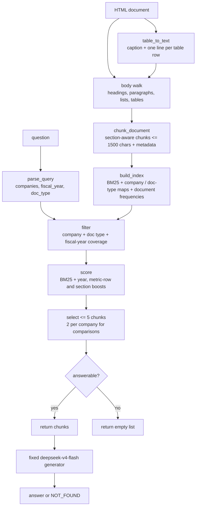

# FTEC5660 Homework 4 — Retrieval for a RAG assistant over company reports

This repository contains my solution to Homework 4. The five graded functions are in
[`hw4.py`](hw4.py); everything below the `Provided code below` line is untouched. The public-test
run produces [`results.csv`](results.csv), and the ablation study is in
[`experiments/ablation.py`](experiments/ablation.py) with its per-variant CSVs.

## Homework 4 solution

### Public-test result

| Task | Score | Measured on `public_test` |
| --- | ---: | --- |
| 1.1 Tables to text | 8 / 8 | 12/12 tables at 1.000 cell score |
| 1.2 Chunking with metadata | 7 / 7 | 40/40 documents pass |
| 2.1 Valid retrieval | 5 / 5 | 100% valid, non-empty on answerable questions |
| 2.2 Query parsing | 10 / 10 | 100% of the three fields correct |
| 2.3 Retrieval recall@5 | 15 / 15 | 46/46 answerable questions hit |
| 3 Abstention | 10 / 10 | kept 100%, rejected 100% |
| 4 End-to-end accuracy | 20 / 20 | 60/60 answers correct |
| **Tasks 1–4** | **75 / 75** | 875 chunks; full run about 6 s (index under 1 s) |

The run used the provided `deepseek-v4-flash` generator (46 calls, about 55.8k input tokens,
USD 0.009). Table parsing, chunking, query parsing, indexing and retrieval make **no** LLM calls;
the only stochastic component is the fixed generator.

### Pipeline



**Parsing.** `table_to_text` expands `colspan`/`rowspan` into a rectangular grid, takes the
`<caption>` (which carries the unit: “USD millions”, “number of people”), and emits one line per
data row in the form `label | header: value | header: value`. Row labels come from the first cell
(a `<th scope="row">` in the balance sheet), column headers from the `<thead>` row (“2025”,
“31 December 2024”, “FY2026E”, “Role”), and section rows that span the whole table are skipped so
they do not pollute the column headers. Lines are capped at 380 characters; a very wide row is
split into continuation lines that repeat the row label, so every value is still on a line with
its own label and header. Negative values keep their parentheses and commas are untouched
(`(1,762.4)`), which matters for both the cell scorer and the generator.

**Metadata and chunking.** `chunk_document` reads the company from `<h1>` (dropping the ticker
parenthesis and a legal suffix), the fiscal year from the title/`Annual Report 2025` /
`Full Year 2025` / `FY2025 results review`, and the type from the same first lines
(`annual_report`, `earnings_call`, `research_report`). It then walks the body in document order and
keeps headings, paragraphs, list items and tables as units. Narrative units are packed to about
1,150 characters per chunk; each table is kept as its own chunk, or split into several chunks with
the caption repeated so a continuation still knows its unit. Every chunk starts with
`Company | Annual Report 2025 | 6. Financial statements > Consolidated balance sheet`, i.e. a
short contextual header made only from that document's metadata and section title. The longest
chunk is 1,497 characters; all 40 public documents keep 100% of their probe values.

**Index.** `build_index` builds a `BM25Okapi` index (`k1=1.5`, `b=0.75`) over lower-cased
alphanumeric tokens, with question scaffolding stop words removed and numbers kept as numbers.
It also stores the chunks grouped by normalised company name and document type, plus document
frequencies for the abstention check. Company names are normalised by `company_key`, so
`Northgate Robotics`, `Northgate Robotics Inc.` and `NORTHGATE ROBOTICS` are the same key.

**Retrieval.** `parse_query` first finds known corpus companies by full-name matching (longest
match wins), masks brokers and auditors so they are never returned as companies, and then extracts
remaining capitalised company-like runs as out-of-corpus companies (for example
`Halcyon Air Cargo`); segment and region names learned from the corpus are rejected as companies.
The year is the `FY...` year, otherwise the single four-digit year in the question (so
“31 December 2024” gives 2024), otherwise `None`. The type is `earnings_call` for call/guidance
phrasing, `research_report` for rating/target-price/forecast/results-review phrasing, and
`annual_report` otherwise.

`retrieve` filters candidates by company and document type, then by fiscal-year coverage. For an
annual-report question it prefers the report of the named year (`FY2025` → the FY2025 report);
if that report does not exist it uses the next year's report, which holds the prior-year column
(FY2023 → FY2024 report). Research reports cover FY2024A–FY2027E in a FY2025 report, and earnings
calls cover FY2025 results and FY2026 guidance. Candidates are scored by BM25 plus a year match,
the presence of the question's metric as a row label (`Revenue | ...` is worth more than a passing
mention), a section hint (`cash` → balance sheet, `employees` → employees table, `auditor` →
independent auditor, `headquarters` → cover, …), and role cues for CFO/CEO/rating/target-price
questions. For comparisons, each company gets at least two slots before the remaining slots are
filled from the global ranking; five chunks of one company are a miss even if they are all
relevant.

**Abstention.** `retrieve` returns `[]` when no parsed company exists in the corpus, when the
named year is outside the corpus coverage (FY2021/FY2022 annual facts, FY2026 annual facts), or
when a content word the question needs is absent from the corpus and from the retrieved chunks
(`lobbying`, `carbon`, `churn`, `single`). That last check uses normalised word variants and
synonyms, so legitimate paraphrases such as “staff”/“headcount” or “borrowing”/“borrowings” do not
trigger a rejection. The generator itself is never asked an answerability question: `[]` is the
only signal it needs, and it is cheap, deterministic and easy to audit.

**Why this design.** The corpus is small and the questions are about named companies, named years
and a small set of financial metrics, so lexical retrieval plus strong metadata is enough. It also
avoids the two failure modes the handout highlights: similar company names (Northgate Robotics vs
Northgate Payments) and two-year columns (FY2025 reports contain FY2024). I deliberately did not
use an LLM in `parse_query`, `build_index` or `retrieve`: rules are inspectable, reproducible, and
fast, and the 30-minute budget is never at risk.

### Ablation study

`experiments/ablation.py` starts from the naive baseline required by the handout and adds one
component per row. `B0` uses `BeautifulSoup.get_text()`, `RecursiveCharacterTextSplitter`
(1,000 characters, 150 overlap), the four required metadata fields, lower-cased whitespace-token
BM25 over the whole corpus, top-5, no query parsing and never `[]`. Every later row changes only
the component named in the table; `V6` is exactly the submitted `hw4.py`. All rows use the same
public corpus, the same 60 questions, the same fixed `deepseek-v4-flash` generator (temperature 0)
and the same scoring functions.

| Variant | One change relative to the row above | Recall@5 | kept | rejected | Answer accuracy | Time |
| --- | --- | ---: | ---: | ---: | ---: | ---: |
| B0 | naive RAG baseline (`get_text`, recursive splitter, whitespace BM25, no parsing, never `[]`) | 28.3% | 100% | 0% | 43.3% | 7.2 s |
| V1 | `table_to_text` + section/table-aware chunking | 78.3% | 100% | 0% | 76.7% | 6.6 s |
| V2 | metadata filtering from `parse_query` (company + doc type) | 89.1% | 100% | 0% | 86.7% | 6.2 s |
| V3 | fiscal-year-aware document selection | 93.5% | 100% | 0% | 91.7% | 6.1 s |
| V4 | per-company quota for comparison questions | 93.5% | 100% | 0% | 91.7% | 6.2 s |
| V5 | richer tokeniser, synonyms, section/metric ranking boosts | 100% | 100% | 0% | 96.7% | 7.0 s |
| V6 | abstention on unknown company, uncovered year, undisclosed metric | 100% | 100% | 100% | 100% | 5.3 s |

`kept` is the share of answerable questions with a non-empty result and `rejected` the share of
unanswerable questions with `[]`; B0–V5 never abstain, so their `rejected` is 0. Accuracy is over
all 60 questions and therefore includes the 14 unanswerable ones; this is why accuracy is higher
than recall in B0 (the generator often says `NOT_FOUND` even when it is handed irrelevant text).
Each row has its own CSV in `experiments/results_<variant>.csv`; the summary is
`experiments/ablation_summary.csv`.

**What each change did.**

* **V1 (table text + chunking): +48.4 recall, +33.4 accuracy.** This is the largest single jump.
  `get_text()` turns a balance sheet into a stream of numbers with no row or column, and the
  recursive splitter cuts through tables and mixes sections. Keeping one line per row with its
  label and year header, and adding a company/year/section header to every chunk, lets BM25 find
  a number that is actually attached to the metric the question asks for.
* **V2 (company + type filter): +10.8 recall, +10.0 accuracy.** Without a company filter, a
  question about one company retrieves another company's nearly identical governance or income
  statement section. In B0, `q010` (“Who was Brightwater Software's CEO?”) returned Corvane,
  Halcyon, Kestrel, Brightwater Energy and Northgate — every company except the right one.
* **V3 (year coverage): +4.3 recall, +5.0 accuracy.** Every annual report contains two year
  columns, so the same metric and company appears in two reports. Preferring the report of the
  named year (and using FY2024 for FY2023 facts) removes the column ambiguity; the effect is
  smaller than the company filter because both copies of a value are identical when they exist.
* **V4 (per-company quota): no measurable change on the public set.** By V3, both companies in
  every comparison question already appeared in the top five, because the company filter leaves
  only two candidate pools and balance-sheet chunks are distinctive. I kept the quota because it
  costs nothing and protects the private set when one company's BM25 score dominates; it changes
  which chunks fill the five slots, not which candidates exist, so it cannot add recall by itself.
* **V5 (ranking): +6.5 recall, +5.0 accuracy.** After filtering, the remaining errors are
  “right document, wrong chunk”. `q040` asks for Kestrel's inventories; V3 returns five chunks of
  the correct FY2025 report (business overview, executive officers, operating income, cover,
  liquidity) but never the balance-sheet row with `162.6`, because whitespace BM25 dilutes the one
  discriminative token in a long chunk and does not connect `inventories` to the balance sheet.
  The richer tokeniser, synonyms and row-label/section boosts put that row back in the top five.
  The same change fixes `q027` (“In which city is Halcyon Freight headquartered?”), where the
  question words `city` and `headquartered` do not occur in the corpus but `Headquarters: Memphis`
  does.
* **V6 (abstention): rejected 0 → 100%, accuracy +3.3.** V5 answers `q044` (“Orchid Bay Resorts'
  operating income in FY2024”) with `231.3`, the FY2024 operating income of the similarly named
  but different Orchid Bay Hotels. V6 parses `Orchid Bay Resorts` as a company, finds no such key
  in the index, and returns `[]`. The same rule fixes `q001` (`Northgate Robotic Systems`), which
  V5 answered with Northgate Robotics' cash.

### Error analysis

1. **B0, `q010` — company confusion.** Question: “Who was Brightwater Software's Chief Executive
   Officer at the end of FY2025?” Retrieved: `doc_031` (Corvane), `doc_016` (Halcyon), `doc_026`
   (Kestrel), `doc_032` (Brightwater Energy), `doc_038` (Northgate). The first passage is a board
   table listing Corvane's CEO; the word “Chief Executive Officer” is generic and BM25 cannot tell
   which company the question is about. The generator answered `NOT_FOUND`. This is exactly the
   failure the metadata filter (V2) removes: candidates are restricted to `brightwater software`
   and `annual_report`, and the FY2025 report's executive-officers table gives `Yara Castillo`.
2. **V3, `q040` — right document, wrong chunk.** Question: “What was the value of Kestrel
   Semiconductor's inventories at 31 December 2025?” Retrieved five chunks, all from the correct
   `doc_026.html`: business overview, executive officers (the CFO change), MD&A operating income,
   the cover, and liquidity. None contains the balance-sheet row
   `Inventories | 31 December 2025: 162.6 | 31 December 2024: ...`. The row exists in the document;
   it simply ranks sixth because the query's other words (`value`, `2025`, `Kestrel`) are common
   and the long balance-sheet chunk dilutes `inventories`. V5's metric-row boost and
   `inventories → balance sheet` section hint move the row into the top five, and the generator
   returns `162.6`.
3. **V5, `q044` — plausible answer to an unanswerable question.** Question: “What was Orchid Bay
   Resorts' operating income in FY2024?” `Orchid Bay Resorts` is a decoy for `Orchid Bay Hotels`.
   V5 retrieves Orchid Bay Hotels' FY2024 and FY2025 income statements plus two other companies
   and the generator answers `231.3`, which is Orchid Bay Hotels' FY2024 operating income — a
   believable but wrong answer. V6 rejects it before generation: the parsed company key is not in
   the corpus index, so `retrieve` returns `[]` and the runner reports `NOT_FOUND`. This is the
   reason abstention is worth its own component: without it, high recall can make the system
   confidently wrong.

### Reproducing the results

From the repository root on Windows (Python 3.10+):

```powershell
python -m venv .venv
.\.venv\Scripts\python.exe -m pip install -r requirements.txt
$env:DEEPSEEK_API_KEY = "your_key_here"    # or put it in .env; .env is git-ignored
.\.venv\Scripts\python.exe hw4.py --data-folder public_test --output results.csv
.\.venv\Scripts\python.exe experiments\ablation.py
```

The first run writes `results.csv` (60 rows, one per question) and prints the public-test
estimates. The ablation script writes `experiments/results_B0.csv` … `results_V6.csv` and
`experiments/ablation_summary.csv`; it needs the API key only for the answer column. Use
`--no-generator` to compute recall/kept/rejected without spending tokens.

Repository layout:

```
hw4.py                         five graded functions + helpers (provided code untouched below the line)
requirements.txt               starter dependencies (bs4, lxml, rank-bm25, LangChain, dotenv)
results.csv                    official public-test run of the final configuration
experiments/ablation.py        B0, V1–V6 ablation driver
experiments/results_*.csv      one result file per variant
experiments/ablation_summary.csv   the table above
public_test/                   40 documents, 60 questions, 12 tables, metadata (course data)
```

## Task 6: Reflection

**What kind of person would I want to be in that world?**
I would want to be the person who knows what is worth doing, not just the person who can do
things quickly. In a world where agents can write, program, research and decide, the scarce
resource is not output; it is direction, judgment and care. I would like to be someone who asks
better questions, who can tell a plausible answer from a true one, and who stays accountable for
the consequences of a decision even when an agent did the analysis. I would also like to remain
someone who is easy to trust: candid about uncertainty, generous with credit, and steady when
things go wrong.

**Which of my current ambitions would still matter?**
The ambitions that survive are the ones that are about understanding and contribution rather than
throughput. I still want to understand how markets, institutions and technologies actually work,
because that understanding is what lets me choose among the answers an agent gives me. I still
want to build things that are useful to real people, and to become excellent at a craft rather
than merely productive at it. I also want to teach and to raise the people around me. None of
those ambitions become obsolete when execution gets cheap; if anything, they become more
important, because there will be more plausible work to choose from and more ways to be busy
without being useful.

**What would I want to be known for beyond productivity and professional achievements?**
I would want to be known for being fair, curious and reliable — the person who tells you the
awkward truth, who reads the appendix before signing off, who remembers the people behind the
numbers. I would like to be remembered as someone who made other people better, not as someone
who produced the most. In this homework, the tempting shortcut was to let a model look at more
text and hope; the better habit was to check what evidence the answer actually rested on. That is
the kind of habit I would want people to associate with me.

**What am I willing to struggle for, even when an AI agent could make the struggle unnecessary?**
I am willing to struggle for understanding, for craft and for relationships. I want to do the slow
work of deriving a result myself, at least once, because the struggle changes what I can notice
later. I want to keep writing and thinking in my own words even when a model can produce a cleaner
first draft, because the act of composing is how I find out what I believe. I am willing to
struggle for people too: to have the difficult conversation, to sit with someone who is stuck, to
repair a mistake instead of hiding it. Those struggles are not inefficiencies; they are how
character is formed.

**What skills, qualities or experiences would still make me valuable?**
Judgment about what matters, taste about what is good, and the ability to verify. Domain depth
still matters: someone has to know which question is worth asking and which number is plausible.
Communication matters more, not less, because a fluent answer is not the same as a clear one.
Ethical reasoning matters, because agents will optimize what we measure and we have to choose the
measures. And the human experiences that cannot be delegated — leading a team through ambiguity,
earning trust, caring for a client, being present for a family — will remain valuable precisely
because they are relational. I would add one more: the ability to work well with agents, to
decompose a problem, specify evidence, and audit the result without outsourcing my judgment.

**If my value is no longer determined primarily by what I can do, how will I define who I am?**
I will define myself by what I choose to attend to, what I am committed to, and how I treat
people. Capability is becoming abundant; attention, commitment and integrity are not. I am the
person who keeps a promise, who notices the person who was left out, who is willing to say “I
don't know” and then go find out. That definition is not a consolation prize for being less
productive; it is a better answer to the question of who I am, because it does not depend on
being faster than a machine.

**What should I start doing differently tomorrow?**
I will start each morning by writing, by hand, the one decision that matters most that day and the
evidence I would need to change my mind — before I open any AI tool. Then I will do the first
45 minutes of that work myself, and only afterwards ask an agent to critique, search or
accelerate. It is a small change, but it puts judgment before generation, and it makes the habit I
want — think first, delegate second, verify always — concrete enough to keep.
